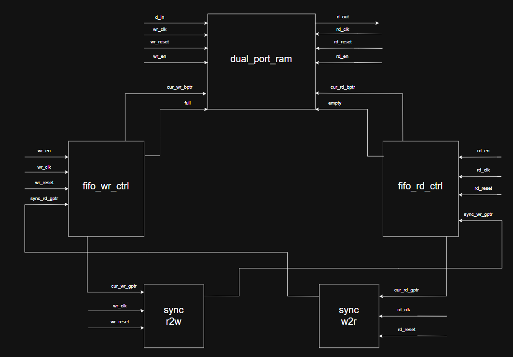
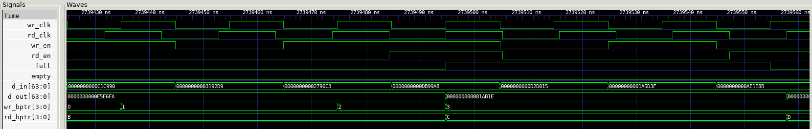

# Asynchronous FIFO in SystemVerilog

## 1. Author

**Author:** Tran Minh Dung  
**HDL:** SystemVerilog  
**Verification:** Cocotb  
**Synthesis:** Vivado

---

## 2. Asynchronous FIFO Introduction and Structure

An asynchronous FIFO transfers data safely between two clock domains that operate independently.

In this project, the write side and read side use different clocks. Directly transferring a multi-bit audio sample between these domains could result in unstable or inconsistent data. The FIFO avoids this by storing the sample in dual-port memory and synchronizing only Gray-coded pointer information between the two domains.

### Reference Architecture



*Figure 1. Block diagram of the implemented asynchronous FIFO. The diagram was created for this project based on the synchronized Gray-pointer FIFO architecture described by Clifford E. Cummings [1].*

The design uses separate write and read clock domains connected through a dual-port RAM.

In this architecture:

- `fifo_wr_ctrl` operates in the `wr_clk` domain.
- `fifo_rd_ctrl` operates in the `rd_clk` domain.
- `cur_wr_bptr` and `cur_rd_bptr` are binary pointers used to address the dual-port RAM.
- `cur_wr_gptr` is synchronized into the read clock domain by `sync_w2r`.
- `cur_rd_gptr` is synchronized into the write clock domain by `sync_r2w`.
- The synchronizer outputs are connected directly to the opposite pointer controllers as `sync_wr_gptr` and `sync_rd_gptr`.
- `fifo_wr_ctrl` generates the `full` flag.
- `fifo_rd_ctrl` generates the `empty` flag.
- The dual-port RAM accepts `full` and `empty` so that writes and reads are blocked when the FIFO cannot accept the requested operation.
- FIFO data is transferred through the dual-port RAM; only Gray-coded pointer values cross between the clock domains.

This figure represents the module names and signal connections used in this project. It is not a reproduction of the original reference figure.

### FIFO structure

The design contains four main parts:

### Dual-port RAM

The dual-port RAM stores the FIFO data.

- The write port operates with `wr_clk`.
- The read port operates with `rd_clk`.
- The two ports access the same memory independently.
- The RAM array is not reset; valid data is determined by the FIFO pointers and status flags.

### Write pointer controller

The write controller operates entirely in the write clock domain.

It:

- Maintains the binary write pointer used to address the RAM.
- Converts the binary pointer into Gray code.
- Advances only when `wr_en = 1` and `full = 0`.
- Compares its next Gray pointer with the synchronized read pointer.
- Generates the `full` flag.

### Read pointer controller

The read controller operates entirely in the read clock domain.

It:

- Maintains the binary read pointer used to address the RAM.
- Converts the binary pointer into Gray code.
- Advances only when `rd_en = 1` and `empty = 0`.
- Compares its next Gray pointer with the synchronized write pointer.
- Generates the `empty` flag.

### Two-stage pointer synchronizers

Two synchronizers transfer pointer information between the clock domains:

- The Gray-coded write pointer is synchronized into the read domain.
- The Gray-coded read pointer is synchronized into the write domain.

Gray code is used because only one bit changes between consecutive pointer values, reducing the risk of sampling an inconsistent multi-bit value during a clock-domain crossing.

---

## 3. Purpose of This Implementation

This FIFO is intended for a larger FPGA audio DSP pipeline:

```text
I²S Receiver → Async FIFO → DSP Core → Async FIFO → I²S Transmitter
```

The first FIFO transfers received audio samples from the I²S receiver clock domain into the DSP processing clock domain.

The second FIFO will transfer processed samples from the DSP clock domain into the I²S transmitter clock domain.

The main goals are to:

- Isolate unrelated clock domains.
- Preserve the order of audio samples.
- Buffer temporary differences in data rate.
- Prevent overflow and underflow.
- Provide a reusable CDC block for the full DSP system.

---

## 4. Testing

### Verification
The FIFO is verified using Cocotb.

The testbench covers:

- Reset behavior
- Multiple data transfers
- FIFO ordering
- Full protection
- Empty protection
- Pointer wraparound
- Write clock faster than read clock
- Read clock faster than write clock
- Nearly equal asynchronous clock periods
- Non-zero clock phase offset
- Randomized concurrent reads and writes
- Scoreboard-based data checking

A Python `deque` is used as the reference scoreboard:

- Every accepted write is added with `append()`.
- Every accepted read removes the oldest expected value with `popleft()`.
- The expected value is compared with `d_out`.

This checks for dropped, duplicated, corrupted, or reordered data.



### RTL
The RTL was also checked with **Verilator** for linting

### Synthesis

The asynchronous FIFO was synthesized using **AMD Vivado 2025.2**, targeting the **Xilinx Zynq-7020 (`xc7z020clg400-1`)** FPGA.

#### Synthesis Configuration

| Parameter | Value |
|---|---|
| Data width | 64 bits |
| FIFO depth | 8 entries |
| Address width | 3 bits |
| Pointer width | 4 bits |
| Write clock | 3.072 MHz |
| Read clock | 100 MHz |
| Clock domains | Asynchronous |

#### Resource Utilization

| Resource | Used | Available | Utilization |
|---|---:|---:|---:|
| Slice LUTs | 60 | 53,200 | 0.11% |
| Slice Registers | 96 | 106,400 | 0.09% |
| BUFGCTRL | 2 | 32 | 6.25% |
| Block RAM | 0 | 140 | 0% |

The FIFO uses minimal FPGA logic resources. For this configuration, its 8 × 64-bit storage is implemented using registers rather than dedicated Block RAM.

#### Timing Analysis

| Timing Metric | Result |
|---|---:|
| Worst Setup Slack (WNS) | +7.202 ns |
| Total Negative Slack (TNS) | 0.000 ns |
| Setup Failing Endpoints | 0 |
| Worst Hold Slack (WHS) | +0.131 ns |
| Total Hold Slack (THS) | 0.000 ns |
| Hold Failing Endpoints | 0 |
| Worst Pulse Width Slack (WPWS) | +4.500 ns |
| Total Pulse Width Negative Slack (TPWS) | 0.000 ns |
| Pulse Width Failing Endpoints | 0 |

*The reported timing results are from standalone Vivado synthesis with asynchronous clock-group constraints.*

**Result:** All reported user-specified synthesis timing constraints are met.

## 5. Results and Conclusion

## 5. Results and Conclusion

The asynchronous FIFO was implemented in SystemVerilog and verified using Cocotb with Verilator. Directed and randomized tests covered FIFO ordering, full/empty protection, pointer wraparound, reset behavior, and operation under different asynchronous clock configurations.

The design was also synthesized using AMD Vivado 2025.2 for the Xilinx Zynq-7020 FPGA.

**Key results:**

- All 18 Cocotb tests passed.
- 60 Slice LUTs and 96 Slice Registers.
- No dedicated Block RAM required for the tested 8 × 64-bit configuration.
- Positive setup slack of **+7.202 ns**, with no reported setup or hold timing violations under the specified constraints.
- The FIFO is parameterized for reuse in FPGA designs requiring clock-domain crossing.

The current implementation has completed RTL development, functional simulation, linting, and standalone synthesis. System-level CDC validation and post-route timing verification remain future integration tasks.

The next development stage is integration into the FPGA audio DSP pipeline:

```text
I²S Receiver → Async FIFO → DSP Core → Async FIFO → I²S Transmitter
```
---

## References

1. Clifford E. Cummings, *Simulation and Synthesis Techniques for Asynchronous FIFO Design*, SNUG 2002.
2. Cocotb Documentation.
3. Yosys Open Synthesis Suite Documentation.
4. Verilator Documentation.
